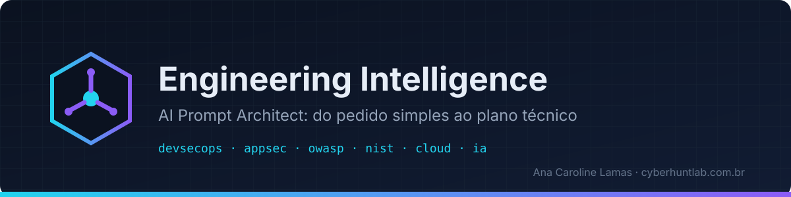

<p align="center"></p>

# Engineering Intelligence — plataforma universal de engenharia e produto

Transforma uma ideia simples, escrita do jeito que você fala, numa especificação técnica e comercial: requisitos verificáveis, segurança, autenticação, painel administrativo, pagamentos e webhooks, monetização, viabilidade e um prompt pronto para uma IA de desenvolvimento. Também gera ideias de startups, projetos de hackathon e pesquisa sinais em fontes reais.

> A base parte das competências de engenharia de software, DevSecOps, AppSec, SecOps, Cloud, IA e pesquisa de segurança de Ana Caroline Lamas. Referenciais extras (SLSA, CIS, ISO, WCAG) entram como conhecimento do motor, não como qualificações atribuídas a ela.

## Módulos (todos usam o mesmo motor central)

| Módulo | O que faz |
|---|---|
| **Prompt técnico** | interpreta o pedido (inclusive com erros de digitação), combina domínios, gera requisitos RF-xxx com teste, normas pertinentes, autenticação, painel, pagamentos, jornada do produto, monetização e viabilidade; nota de qualidade explicada |
| **Startups e ideias** | 126.300 combinações problema × segmento × abordagem × variação, geradas sob demanda (nada armazenado); filtro por tema; ideia completa com pitch, MVP, validação e prompt |
| **Hackathon** | lê o regulamento colado (tema, critérios e pesos, prazos, duração, tecnologias, submissão) e gera projetos alinhados, com plano por horas, demo e roteiro de pitch |
| **Pesquisa** | consulta GitHub e Hacker News com fonte, data e confiabilidade; mostra quais fontes não estão integradas e por quê |
| **Histórico e favoritos** | guarda gerações e ideias favoritas no navegador; exporta JSON/Markdown |
| **Configurações** | estado do provedor de IA, fontes de pesquisa e consumo da instância |

## Exemplo

*"Quero vender meu curso na hotmat e na kiwfy com login com Google e liberar acesso por webhook"*

- Entende **Hotmart** e **Kiwify** e pede confirmação da correção.
- Domínio: produto digital com área de membros (não loja física).
- Requisitos: área de membros com URLs assinadas, login com Google (OIDC com PKCE, state e nonce), webhooks com verificação pelo mecanismo oficial, idempotência e proteção contra replay, ciclo de acesso (liberar, suspender, revogar em reembolso e chargeback), painel administrativo com MFA e auditoria.
- Documentação oficial verificada das duas plataformas; eventos e formatos devem ser conferidos nela (a ferramenta não inventa eventos).
- Monetização: produto digital e afiliados, como cenários; jornada completa de 11 etapas; viabilidade com premissas.

## Princípios

- **Nada inventado:** sem endpoints, eventos, demanda, receita ou concorrentes fictícios. Hipóteses e estimativas são rotuladas como tal.
- **Sem caixa-preta:** cada norma vem com motivo, verificação e evidência; cada ideia mostra o que precisa ser validado; a nota mostra as deficiências.
- **Proporcional:** script local não ganha painel administrativo nem monetização; projeto pessoal ou educacional não recebe análise comercial (pode ser ativada).

## Estrutura

```
index.html  styles.css  app.js  modules.js   interface (HTML/CSS/JS puro, sem dependências)
lib/engine.js          motor central (interpretação, requisitos, normas, revisão, nota)
lib/knowledge.js       base de conhecimento (14 domínios, 18 referenciais)
lib/specialists.js     autenticação, painel, pagamentos/webhooks, monetização, jornada, viabilidade
lib/ideas.js           startups e hackathons sob demanda
lib/research.js        provedores de pesquisa (extensível)
lib/store.js           histórico e favoritos no navegador
api/generate.js        POST /api/generate (refinamento opcional por IA)
api/research.js        POST /api/research
api/health.js          GET /api/health (estado e consumo, sem segredos)
tests/                 59 testes (node:test)
tools/compare.mjs      comparação com a v1 nos 15 cenários
RELATORIO-COMPARATIVO.md  RELATORIO-SEGURANCA.md
```

## Rodar e testar

```bash
npm test                 # Node 18+, sem instalar nada
node tools/compare.mjs   # tabela v1 × atual
npx vercel dev           # servidor local com as funções (pesquisa e IA)
```

## Deploy na Vercel

1. Importe o repositório. Não há build: site estático + funções em `api/`.
2. (Opcional) Cadastre as variáveis de [`.env.example`](.env.example):
   - IA: `AI_PROVIDER` (`openai` ou `gemini`), `AI_API_KEY`, `AI_MODEL`, limites.
   - Pesquisa: `GITHUB_TOKEN` (opcional, só aumenta o limite), `RESEARCH_LIMIT_PER_IP`.

Sem variáveis, tudo funciona com o motor local; a pesquisa usa as APIs públicas.

## Integrações

| Fonte | Estado |
|---|---|
| GitHub (busca de repositórios) | ativa, API pública |
| Hacker News (API do Algolia) | ativa, sem chave |
| OpenAI / Gemini | opcional, por variável de ambiente |
| Reddit, Product Hunt, Google Trends, Devpost, busca web | não integradas (credencial, termos ou ausência de API pública); listadas com o motivo |

## Limitações

- O motor funciona por regras e conhecimento cadastrado; fora dos 14 domínios, usa decomposição genérica e avisa na nota.
- As ideias de startup são combinações plausíveis, não oportunidades comprovadas.
- A pesquisa ao vivo depende das APIs externas e foi testada com respostas simuladas no formato documentado.
- Limites de uso ficam em memória por instância (melhor esforço).

## Licença

MIT · Ana Caroline Lamas · [cyberhuntlab.com.br](https://cyberhuntlab.com.br)
